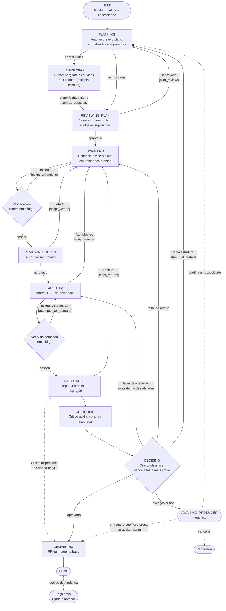

# Fluxo da peça

Este é o diagrama do fluxo de uma peça, redesenhado em 2026-11-14 a partir da [arquitetura](arquitetura.md) v0.31 (P13 e §5.4), e conferido com a v0.32 em 2026-11-14. Ele substitui o [diagrama do dono de 2026-10-30](<Produtor-Roteirista Merge Workflow-2026-10-30-191336.png>), que fica como registro histórico. Quando os dois divergirem, vale a §5.4 da arquitetura.

## Como ler

- **Contadores** (entre colchetes): cada volta para trás tem um contador em `limits`. Quando um contador esgota, a peça vai a **AWAITING_PRODUCER**, e isso vale para qualquer contador, mesmo que o diagrama não desenhe essa seta em cada laço.
- **Reprovações do Crítico:** com mais de `Nc` reprovações, a falha passa a ser estrutural.
- **Menu fixo** (setas tracejadas que saem de AWAITING_PRODUCER):
  - redefinir a necessidade;
  - aumentar o limite e continuar, que dá mais uma rodada ao laço que esgotou e devolve a peça ao ponto em que ela parou, por isso não tem seta;
  - entregar o que ficou pronto;
  - aceitar assim, só depois de uma reprovação do Crítico e com a dispensa do Crítico registrada;
  - cancelar.
- **O menu fixo vem do código:** as opções são as cinco acima, e ele não segue o limite de 2 a 4 opções do `ask_producer` (decisão do dono de 2026-11-14, v0.32).
- **Dispensa do Crítico ao abrir a peça** (seta tracejada de INTEGRATING): é uma decisão registrada do Produtor, com motivo, e vale para a peça inteira. A máquina pula CRITIQUING e DECIDING e vai de INTEGRATING a DELIVERING. O PR informa que o Crítico foi dispensado, por quem e por quê.
- **Exceção crítica:** leva ao Produtor sem esperar contador. É uma lista fechada:
  - necessidade impossível ou contraditória;
  - falta de acesso, credencial ou permissão;
  - risco de segurança ou de perda de dados;
  - decisão fora do escopo do plano.
- **Depois da entrega:** um pedido de mudança abre uma peça nova, ligada à anterior. Se o PR ainda está aberto, a peça nova trabalha na branch dele.

### Valores dos contadores

| Contador | `moderate` (padrão) | `economical` | `persistent` |
|---|---|---|---|
| `plan_reviews` (`Np`) | 2 | 1 | 3 |
| `critic_rejections` (`Nc`) | 2 | 1 | 3 |
| `attempts_per_demand` | 3 | 2 | 4 |
| `script_validations` | 3 | 2 | 4 |
| `script_vetoes` | 2 | 1 | 3 |
| `script_returns` | 2 | 1 | 3 |
| `structural_restarts` | 1 | 0 | 2 |

A cada recomeço estrutural, os outros contadores zeram.

## O que cada papel faz

| Papel | Faz | Não faz |
|---|---|---|
| Produtor | Define a necessidade; responde às dúvidas | — |
| Autor | Escreve o plano (o quê e por quê); declara dúvidas e suposições; revisa todo roteiro, inclusive se cada dependência entre demandas tem motivo | Dividir em demandas; escrever código |
| Revisor | Confere o plano contra a necessidade e as respostas; julga as suposições | Reescrever o plano |
| Roteirista | Divide o plano em demandas prontas, com contratos; indica pelas dependências o que pode rodar em paralelo | Mudar o plano |
| Diretor | Coordena, pergunta ao Produtor, classifica a crítica | Planejar, dividir ou escrever código |
| Ator | Escreve o código que atende uma demanda pronta | Planejar, mudar escopo ou contrato, decidir pelo Produtor |
| Crítico | Avalia o trabalho integrado | Corrigir |

Uma **demanda pronta** traz:
- a descrição;
- os critérios de aceite;
- os contratos de entrada e saída;
- os `expectedFiles`;
- pelo menos um passo `verify`, ou o motivo de não haver (`verifyWaiver`).
